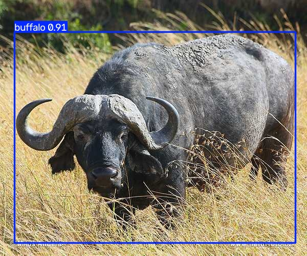

# Assignment 3 - YOLO

## 1. 任务说明

我选择检测的目标是南非自然保护区中的四种动物：水牛（buffalo）、大象（elephant）、犀牛（rhino）和斑马（zebra）。

## 2. 数据集

数据集名称：African Wildlife Detection Dataset（Ultralytics 改编版）

数据集来源：

- 原始数据：Bianca Ferreira，https://www.kaggle.com/datasets/biancaferreira/african-wildlife
- 本次使用的 YOLO 配置与自动下载版本：https://docs.ultralytics.com/datasets/detect/african-wildlife
- 压缩包：https://github.com/ultralytics/assets/releases/download/v0.0.0/african-wildlife.zip

包含哪些类别：buffalo、elephant、rhino、zebra。共 4 类，1504 张图，已划分为 train 1052 张、val 225 张、test 227 张。标签是 YOLO 格式。

数据集目录里：

- `images` 是原始图片。
- `labels` 是与图片同名的 `.txt` 标注。每一行是一个目标：`class_id x_center y_center width height`，后四个数都除以图像宽或高，范围是 0 到 1。
- `train` 是训练集。模型反复看这些图，根据预测和标签的差距更新权重。
- `val` 是验证集。每个 epoch 结束后在这批图上检查效果，用来挑选 `best.pt`，这批图不参与更新权重。

## 3. 模型训练

使用的 YOLO 版本：Ultralytics 8.4.175，模型为 YOLO11n。

使用的预训练模型：`yolo11n.pt`。它先在 COCO 的 80 类上训练过。本次训练把它的检测头改成上面的 4 类，再在 African Wildlife 上继续训练。

训练在 conda 环境 `yolo` 中进行，工作目录是 `/home/dong`。实际命令：

```bash
yolo detect train \
    model=yolo11n.pt \
    data=african-wildlife.yaml \
    epochs=30 \
    imgsz=640 \
    batch=8
```

主要训练参数：

- epochs：30
- imgsz：640
- batch：8
- data：african-wildlife.yaml

训练在 NVIDIA GeForce RTX 5070 Laptop GPU 上完成，30 个 epoch 约 0.046 小时。权重保存在：

```text
/home/dong/runs/detect/train/weights/best.pt
/home/dong/runs/detect/train/weights/last.pt
```

推理使用 `best.pt`。验证集上该权重大约达到 precision 0.963、recall 0.883、mAP50 0.951。

## 4. 模型测试

测试使用自己训练得到的 `best.pt`，图片来自数据集的 test 划分，没有参与训练。在 conda 环境 `yolo` 中执行：

```bash
yolo detect predict \
    model=/home/dong/runs/detect/train/weights/best.pt \
    source="/home/dong/datasets/african-wildlife/images/test/1 (103).jpg" \
    imgsz=640 \
    conf=0.25 \
    save=True
```

终端输出：`1 buffalo`。结果图上可以看到类别名、边界框和置信度。



本次测试图中检测到 1 头水牛（buffalo），置信度 0.91。

## 5. 对 YOLO 的理解

1. YOLO 是用来做什么的？

   YOLO（You Only Look Once）用来做目标检测。一张图输入后，它找出图里有哪些目标、每个目标属于哪一类，以及每个目标在图中的位置。它和图像分类不同：分类只给整张图一个类别；检测可以在同一张图里标出多个物体。YOLO 把整张图做一次前向计算，直接得到这组结果。

2. 一张图片输入 YOLO 后，会输出什么？

   对每个被检出的目标，模型输出类别、边界框和置信度。一张图里可以有零个、一个或多个目标，所以输出是一个检测列表。推理时还会做非极大值抑制，去掉重叠的重复框。

3. 什么是类别（class）？

   类别是数据集预先规定的物体种类。本次只有 4 类，编号从 0 开始：0 buffalo、1 elephant、2 rhino、3 zebra。模型只能在这张名单里选择，不会发明新类别。

4. 什么是 Bounding Box？

   Bounding Box 是包住目标的轴对齐矩形。YOLO 标签用归一化的中心点坐标和宽高表示：`class_id x_center y_center width height`。例如 `0 0.52 0.48 0.31 0.40` 表示类别 0（buffalo），中心大约在图像正中，宽约占图像宽度的 31%，高约占图像高度的 40%。

5. 什么是 Confidence？

   Confidence 是模型对这条检测结果的把握，范围是 0 到 1。0.91 比 0.25 更确信框里是该类别的目标。推理时可以用 `conf` 丢掉低分框。它不是人工标注，只在预测阶段出现。本次结果图上的 `buffalo 0.91` 就是类别和置信度。

6. 数据集和标签分别是什么？

   数据集是用来训练和检查模型的图片，以及说明每张图里有什么的标注。标签是每张图对应的标注文件。一张 `images/train/xxx.jpg` 对应一个同名的 `labels/train/xxx.txt`。

7. Training 和 Predict 有什么区别？

   Training 使用带标签的图片，正向算出预测后再反向传播，按误差更新模型权重，产物是 `best.pt` 和 `last.pt`。Predict 只做一次正向计算，用已经固定的权重对新图片输出类别、边界框和置信度，不再修改权重，也不需要标签。

8. 预训练权重是什么？

   预训练权重是已经在大规模数据上训练过的参数文件。本次的 `yolo11n.pt` 先在 COCO 上训练，已经具备边缘、纹理和常见物体的特征。在 African Wildlife 上继续训练叫做微调：不必从随机参数学起。文件名里的 `n` 表示 nano，参数约 259 万，适合入门。

9. epoch 是什么？

   一个 epoch 是把训练集完整看过一遍。`epochs=30` 表示训练循环进行 30 遍。同一张图在不同 epoch 里会配合随机增强，以不同样子出现。

10. 训练得到的 `.pt` 文件是什么？

    `.pt` 是 PyTorch 保存的检查点，里面是网络结构和学到的参数，也包含类别名。`best.pt` 是验证集指标最好的那一轮，推理时加载它。`last.pt` 是最后一轮的权重。加载 `best.pt` 后，模型按这 4 个类输出结果，而不是回到 COCO 的 80 个类。
